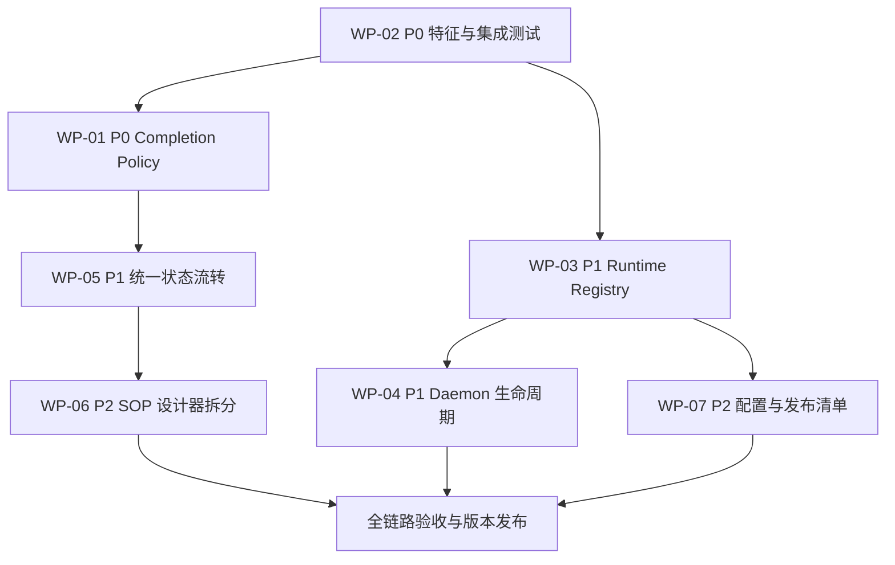
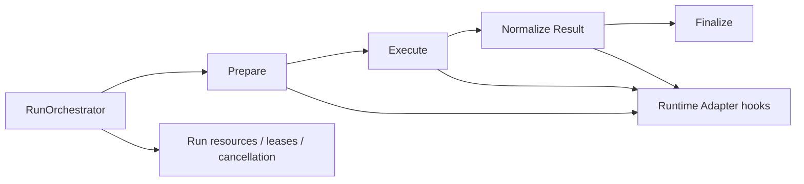

# MEPERStudio 核心架构重构计划

> 基线：当前仓库 `ae20bfa`（2026-11-26）。本计划覆盖全部七项架构治理任务；它是一份实施路线图，并不表示代码已经重构或上线。
> 本轮实施及验证结果参见 [架构重构实施与验收记录](architecture-refactoring-results.md)；平台实机及生产发布门槛仍按本文验收标准执行。

## 1. 目标与范围

在不推倒现有系统、不破坏存量 Workspace、SOP、Agent 和 Daemon 的前提下，建立以下长期可维护的边界：

- **Workflow:** 领域规则是唯一可信来源；配置、执行、评估、审核、返工和状态流转一致，可独立测试。
- **Runtime:** 新增 Runtime 通过注册适配器与能力描述完成，不要求修改通用执行流程、前端业务判断或数据库 Provider 枚举。
- **Daemon:** 通用生命周期与 Provider 特有环境/协议分离；资源、并发和故障恢复约束仍由公共层负责。
- **Frontend:** SOP 设计器只负责编辑与展示，消费后端定义的契约和能力，不独立推导业务结果。
- **Distribution:** 品牌配置、环境变量和 CLI 发布元数据由明确的规范统一，多平台客户端读同一来源，兼容历史版本。

不在本轮范围内：推翻现有工作流数据模型、任意 DAG/并行 Stage 引擎、换数据库、重写 Electron/移动端或重新命名内部数据库 ID 和历史协议。除非发现已有产品行为必须修复，否则保持 API、事件、任务和发布版本兼容。

## 2. 工作包与交付顺序

| 优先级 | 工作包 | 重构项目 | 主要目标 | 前置依赖 | 估算人日 |
|---|---|---|---|---|---:|
| P0 | WP-01 | Workflow Completion Policy | 配置与实际执行一致，明确成功交付规则 | WP-02 基线测试 | 4–6 |
| P0 | WP-02 | Workflow 核心业务测试 | 覆盖审核、重试、返工、状态流转与并发 | 无，第一项启动 | 5–7 |
| P1 | WP-03 | Runtime Registry 与能力模型 | 新增 Runtime 不需要跨层逐处修改 | 基线 Runtime 行为样本 | 6–9 |
| P1 | WP-04 | Daemon 执行生命周期拆分 | Provider 专属行为移入适配层 | WP-03 | 6–9 |
| P1 | WP-05 | 统一 Workflow 状态流转服务 | 人工与 Agent 阶段共享流转规则及事务服务 | WP-01、WP-02 | 5–7 |
| P2 | WP-06 | SOP 设计器组件拆分 | 领域规则与视图拆分，降低 UI 维护成本 | WP-01、WP-05 的契约稳定 | 3–5 |
| P2 | WP-07 | 配置及发布清单标准化 | 多端配置与发布元数据一致，保留旧客户端兼容 | WP-03 的能力契约稳定；与 WP-06 可并行 | 4–6 |

合计初步估算 **33–49 人日**。这是工程工作量区间，不是交付承诺；应在每个阶段完成特征测试、数据兼容检查后更新估算。单人顺序实施约 7–10 个工作周；多人并行仅限独立工作包，不并行改写同一状态机或同一执行入口。

P0 修复与测试全部通过后再合并 P1 重构。WP-03 和 WP-05 在边界隔离且基线稳定后可独立推进；WP-04 必须在 WP-03 契约稳定之后执行。

## 3. WP-02（P0）：先建立 Workflow 业务回归测试

### 现状

- `core/internal/service/workflow_*.go` 和 `core/internal/handler/workflow*.go` 是核心业务实现，但当前仓库没有命名为 Workflow 的专用 Go 测试文件。
- 已有的全量 Go 测试通过不等于 Workflow 的真实事务、并发和生命周期行为已覆盖。

### 实施清单

- [ ] 建立可复用的 Workflow fixture：Workspace、成员、Agent、Runtime、SOP 版本、多 Stage、任务、执行及结果。
- [ ] 在 `core/pkg/workflowcontract/` 增加契约解析、输入绑定、输出验收、重试/返工策略的表驱动单元测试。
- [ ] 增加 `core/internal/service/workflow_*_test.go`，覆盖现有可观测行为，区分已确认缺陷（拟修复期望）与历史正常行为（必须保留）。
- [ ] 使用隔离 PostgreSQL 数据库应用真实迁移，在事务测试中验证行锁、CAS/版本、唯一约束、幂等重放及并发竞争。已有生产数据不得作为测试数据库。
- [ ] 为 HTTP Handler 增加契约测试，验证失败状态码、错误码、响应结构和跨 Workspace 隔离。
- [ ] 增加独立的可重复测试入口，并接入现有构建/CI 流程；无现成 CI 时先明确本地命令和依赖，后续配置 CI。

### 最低必测矩阵

| 场景 | 必须验证 |
|---|---|
| 人工阶段通过/拒绝 | 所有必需任务完成、权限、原因、当前版本和状态一致 |
| Agent 阶段 | 运行、结果契约验证、自动验收、人工审核、Agent 审核、混合审核 |
| 状态前进 | 任意数量阶段、最后阶段完成、单次后续执行生成 |
| 重试 | 瞬态/永久故障、上限、执行 attempt、重试不重复提交副作用 |
| 返工 | 目标阶段正确、旧结果及后续审核失效、历史证据保留、重新绑定输入 |
| 并发 | 双重审批、审批与返工竞争、重复事件、worker 重放只产生一次状态变化 |
| 计划编辑 | 已接受结果不被现有编辑悄悄覆盖；运行实例快照/版本正确 |
| 失败恢复 | 事务回滚、过期状态令牌、执行取消、断线或重启后恢复 |
| 权限与隔离 | 非授权审核人拒绝、跨 Workspace 引用拒绝、运行时权限不回退 |

**验收：** 所有上述场景有确定性的测试用例，并能在独立环境运行；已确认缺陷的测试可以在修复前失败、修复后通过。不能以行覆盖率替代业务不变量验证。

## 4. WP-01（P0）：Workflow Completion Policy

### 现状与证据

- `packages/views/workflows/components/project-sop-designer.tsx:1066` 保存 `evaluation_mode`、`schedule`、`allowed_task_statuses`。
- `core/internal/handler/workflow.go:481` 强制 Agent 使用 `validated_result`，但人工阶段只检查配置是否为 JSON object。
- `core/internal/handler/workflow.go:1638` 实际只接受所有任务为 `done`。
- `core/migrations/0001_task_domain_baseline.up.sql:1953` 和 `:2050` 默认是 `all_runs_terminal`，与前端默认不同。

### 目标契约

建议在现有 `core/pkg/workflowcontract/` 内增加版本化 Completion Policy，复用已有 Contract、RetryPolicy 和 ReworkPolicy 的解析/验证模式。Policy 的判断结果应包含 `ready`、原因代码、缺失的任务/结果/产物、评估时间与证据版本。**完成就绪不等于审批通过，也不等于状态自动前进。**

| 现有/新增字段 | 语义与兼容原则 |
|---|---|
| `all_tasks_terminal` | 兼容现有人工 Stage；默认成功交付仍要求必需 Task 为 `done`，不把取消、阻塞或进行中视为成功 |
| `all_runs_terminal` | 历史数据库默认；按 Stage 类型和实际历史配置解析为明确的兼容策略，不能静默改变既有验收结果 |
| `validated_result` | Agent Stage 必须有通过数据/产物契约验证的当前结果版本，并满足审核策略 |
| `allowed_task_statuses` | 现有默认包含 `todo`、`in_progress`，因此**不得用作成功状态集合**；先明确为任务生命周期可选状态/显示配置，或移除尚未定义的行为 |
| `evaluation_mode` | 明确 `manual`、`on_task_change`、`scheduled` 触发的是重新评估就绪状态；是否自动推进另由明确策略决定 |
| `schedule` | 采用可验证的调度表达式与时区；不可解析时拒绝保存，兼容旧自由文本时保留原值并提示修正，不猜测执行 |
| 输出要求 | 明确人工/Agent Stage 的输出证据来源、缺失项及验证方法；未实现的产物验证不在 UI 声称已支持 |

### 实施清单

- [ ] 编写领域规则与兼容决策表，确认各状态、必需任务、取消任务、零任务、输出缺失、回滚/重试结果的处理。
- [ ] 定义 Go 结构体、解析器、校验器及纯评估函数；未知策略应显式拒绝或返回不支持，而不是自动通过。
- [ ] 创建统一 Completion Evaluator，接入人工阶段流转、Agent 结果验收，以及就绪状态查询。
- [ ] 在锁定的业务证据快照上重新评估后再提交审批/流转，防止读取与提交之间结果变化。
- [ ] 实现任务变更事件与定时评估：沿用现有 worker、调度机制和幂等处理。评估不会隐式越过 Gate，不额外触发非预期自动推进。
- [ ] 发布后端可支持的 Policy、Evaluation、输出要求能力；前端和 API 对不支持项隐藏或明确拒绝。
- [ ] 使用新增迁移修正新记录默认，读取层兼容旧 JSON；迁移前记录受影响 Stage 数量与配置分类。历史执行快照、审核证据和已接受结果原样保留。
- [ ] 通过 WP-02 的新旧数据、规则矩阵和并发验收。

**验收：** 用户配置的受支持模式确实重新评估，界面展示与后端一致；不支持的配置无法被误认为生效；取消或未完成任务不能意外通过；重评估不改变已审核证据，不跳过人工/Agent Gate。

## 5. WP-03（P1）：Runtime Registry 与能力模型

### 现状

`core/pkg/agent/agent.go:80` 已有 `Backend` 接口，但探测、模型、Skill、MCP、会话、显示名和 CLI 约束分别散落在 `agent.go`、`models.go`、`launch.go`、`daemon/agents_probe.go`、`daemon/config.go`、`daemon/local_skills.go`、`execenv`、数据库约束和前端。新增 ZCode 已经暴露出这些分散定义的扩展成本。

### 目标设计

- 在 Go 代码中建立唯一内建 Runtime Registry。每个注册项由稳定 Runtime ID、协议实现、Backend 工厂、探测策略及能力描述构成。
- 通过能力而非 Runtime 名称选择通用行为。能力包含模型选择方式（可选/由 CLI 管理）、Skill/MCP、上下文载入、会话恢复、事件与结果格式，以及对应的版本/可用性限制。
- 将静态能力与单台机器探测的动态能力区分开；前端读取后端/API 能力目录（或从同一规范生成类型），不直接根据 `provider === "zcode"` 等推断。
- 不需要立刻支持任意第三方代码插件；内建 Registry 足以解决本轮问题。能力标识、Runtime ID 和协议家族的语义应分离，历史 `protocol_family` 仍保持读写兼容。

### 实施清单

- [ ] 建立现有全部 Runtime 的能力与探测行为清单，加入快照/契约测试。
- [ ] 抽取 Registry 和描述器，现有 Backend 构造器注册到同一来源；提供已注册 ID 查询、唯一性验证与错误提示。
- [ ] 将 CLI 探测路径、启动参数能力、模型发现、Skill 目录、配置方式及展示信息逐步迁移到描述器/适配器实现，保持 Provider 具体协议行为。
- [ ] 更新 RuntimeProfile API 校验为 Registry 支持校验；采用扩展兼容的数据库约束，保留非空/格式等数据不变量。禁止直接移除应用层对未知协议的验证。
- [ ] 分阶段处理数据库 Provider 枚举约束：先部署能读旧/新描述的代码，再扩展约束；旧 Daemon 不认识的类型标为不支持，不要求执行。
- [ ] 给 API 增加版本化能力字段，先保持现有字段不变；Web/Desktop/Mobile 对缺失新字段保留旧行为的受控兼容。
- [ ] 统一前端 Runtime 列表、模型选择、能力提示；替换分散的名称特判。指标未知 Runtime 归入有界类别，避免不受控标签增长。
- [ ] 建立一个仅用于测试的最小 Runtime 适配器，验证扩展时无需修改 Daemon 通用执行流程、数据库迁移和前端业务组件。

**验收：** 所有现有 Runtime 通过基线契约测试；新增测试 Runtime 只需要注册描述器、实现适配器和测试。无效/未知 Runtime 明确拒绝或报告不支持，不会误执行。已有 Runtime Profile 数据与老客户端兼容。

## 6. WP-04（P1）：Daemon 执行生命周期拆分

### 现状

`core/internal/daemon/daemon.go:4897` 中 `executeRun` 约 1,188 行，集中处理准备、Provider 专属配置、会话恢复、环境变量、执行、排空消息、清理与重试。`core/internal/daemon/execenv/` 已有环境准备能力，应优先复用而非重写。

### 目标结构

通用生命周期统一管理租约、并发 slot、超时、取消、资源释放、认证上下文、状态上报和幂等结果；适配器负责 Provider 特有环境准备、会话恢复规则、参数构建及协议结果解释。避免为每个 Provider 复制整条执行流程。

### 实施清单

- [ ] 建立 `executeRun` 行为特征测试及分段步骤图，记录执行前失败、取消/超时、重试和清理顺序。
- [ ] 提取明确的 RunContext/PreparedRun、RunResult 等类型与阶段接口。仅移动通用逻辑，首个提交不改变 Provider 行为。
- [ ] 将 Codex 会话存储/恢复、Cursor MCP、Hermes 配置、OpenCode 超时、ZCode 模型等特殊处理逐个迁入 Registry 对应策略或适配器，保持所需钩子粒度而非一个巨大接口。
- [ ] 把任务凭证注入、环境变量保留/过滤、临时目录及工作树清理作为共享资源管理；不得让 Provider 接管全局凭证策略、并发槽或任务状态权威。
- [ ] 保持现有运行时特性：断线重连、resume/fresh fallback、消息顺序、结果导出、任务取消、工作区锁和用户文件保留。
- [ ] 每迁移一组适配器即运行基线测试与真实平台烟测，逐步去掉通用层中的 Provider 名称分支。确需跨 Provider 的差异，用能力/策略表示并解释例外。

**验收：** 原 `executeRun` 变为清晰的生命周期编排；增加 Provider 不修改通用状态流转；任何退出路径都正确回收 slot、锁、临时资源，失败/取消不会被错误上报为成功。以职责和测试验收，不以机械行数 KPI 验收。

## 7. WP-05（P1）：统一 Workflow 状态流转服务

### 现状

`core/internal/handler/workflow.go:1500` 人工阶段流转与 `core/internal/service/workflow_acceptance.go:99` Agent 阶段验收推进分别修改实例状态，并各自处理下一 Stage 与后续执行。`core/pkg/db/queries/workflow.sql:250` 以 Stage position 获取下一个阶段。

### 目标设计与实施

- [ ] 建立 Workflow domain 状态与事件、合法转换表、转换结果及拒绝原因。区分实例状态与阶段执行状态，避免混用。
- [ ] 单一 `WorkflowTransitionService` 处理开始、评估就绪、审批、拒绝、接受结果、进入下一阶段、等待、重试/返工及完成；按事件分派具体领域策略。
- [ ] 把合法下一个 Stage 的选择抽象为明确的 `NextStageResolver`；现有实现继续采用顺序 Stage。保留配置的回退 stable key。不在本轮引入任意图执行。
- [ ] 将 HTTP Handler 改为解析请求/身份、调用服务、返回响应；公共服务负责一致性校验、事务加锁、写入审核证据、实例更新、后续执行创建及提交后的事件发布。
- [ ] 人工、Agent、自动及混合审核共享状态推进逻辑，但各自的权限、审核依据、输出契约、状态令牌/版本校验保持独立且严格。
- [ ] 接入现有重试/返工服务及 worker，使用 WP-01 Policy，确保失效结果不被后续 Stage 读取。
- [ ] 配套完善单元测试（转换表）和 PostgreSQL 并发测试（双重提交、重复事件、回滚、审批竞争）；迁移旧入口后删除真正重复的流转分支。

**验收：** 现有 API 与存量数据兼容；人工与 Agent 的成功推进都通过同一领域服务；非法跳转、重复推进及错误结果被拒绝；保留审核证据、任务权限和事务保证。旧 Handler 的直接状态更新不再承担业务决策。

## 8. WP-06（P2）：SOP 设计器组件拆分

### 现状与实施

`packages/views/workflows/components/project-sop-designer.tsx` 约 2,341 行，同时负责模板、草稿、映射、技能、表单、校验和提交。应在 WP-01/WP-05 API 契约稳定后拆分。

- [ ] 将 `SopStageDraft`、序列化/反序列化、模板注册与默认值放入独立模型模块，避免在 JSX 层拼装完成规则。
- [ ] 将模板库、Stage 列表/排序、Stage 编辑器、输入输出契约、Completion Policy、审核 Gate、重试返工、技能/MCP 选择、发布预览拆成职责单一的组件；复用已存在的 `stage-execution-fields.tsx` 等模块。
- [ ] 提取 `useSopDesigner` 或同类控制器，管理编辑状态、保存/发布网络请求与错误。表单子组件不直接修改服务端状态。
- [ ] 通过 WP-01 后端支持的策略目录约束表单，消除前端独立业务判断；保留旧字段的可展示性。复杂不可支持的旧配置只读展示/显式迁移，不静默覆盖。
- [ ] 序列化 round-trip 测试：打开旧 SOP → 修改单一字段 → 保存 → 重读；未修改的字段、stable key、技能引用、版本及 Gate 不丢失。
- [ ] 增加交互测试：新建、模板选择、增删/排序 Stage、校验错误、保存/发布、计划编辑、冲突处理；保持 Web/Desktop 共用行为。

**验收：** 原有用户流程与视觉布局仍可用；表单只展示实际支持的能力；所有关键序列化/交互测试通过；不为拆分而增加重复状态或过度通用组件。

## 9. WP-07（P2）：配置及发布清单标准化

### 现状

已存在 `core/internal/branding/branding.go`、`packages/views/common/cli-commands.ts`、`scripts/build-cli-release.py` 等初步统一模块；但 Python、Go、TypeScript、Shell 和 PowerShell 仍分别推导包名，旧新环境变量的转换分散且全局。

### 配置规范

- [ ] 建立版本化配置键规范/兼容表：canonical 名称、旧名称、用途、默认值、合法值、作用域及弃用状态。
- [ ] 将配置解析与优先级集中到边界：命令参数 > `MEPERSTUDIO_*` > 兼容 `SILIECO_*` > 配置文件 > 默认值。在内部传递已验证的 typed config，而非让业务逻辑重复读取环境变量。
- [ ] 逐步移除内部全局前缀转换依赖；分别管理服务端、Daemon、CLI、Desktop 和任务级配置。任务凭证不得从普通配置或父环境混入。保持现有新旧 profile 目录兼容，不改内部协议/存储 key。
- [ ] 统一 Go/Electron 对状态目录选择的规则与跨语言测试向量，保证新旧配置并存结果一致。文档与 Compose 从同一规范更新，存量 `.env` 不自动覆盖。

### Release Manifest

- [ ] 建立版本化 `manifest.json`（建议字段为版本、平台、架构、归档路径、内部可执行文件名、大小、SHA-256、兼容/协议版本），构建脚本独占生产元数据的职责。
- [ ] 稳定下载指针指向不可变的版本化发布目录。所有文件及哈希生成并验证后发布清单，避免半发布时版本与校验不一致。
- [ ] Go CLI updater、Desktop CLI bootstrap、Web 下载页和 Shell/PowerShell 安装器消费同一清单及测试向量，不再各自维护命名/选择规则。旧客户端保留旧包名、`checksums.txt`、`version.txt` 和相应下载路径，兼容期通过客户端覆盖情况再决定是否退役。
- [ ] 保留传输、归档、SHA-256 验证与原子本地替换；清单路径限制在预期发布目录，拒绝缺失或不匹配的文件、版本、目标平台。
- [ ] 本地、Docker 发布产物使用相同构建脚本；以真实 HTTP 下载、校验、安装、启动、更新及失败恢复测试覆盖 macOS/Linux/Windows × AMD64/ARM64。

**验收：** 发布新版本时只由生成器定义平台/文件名；新客户端均从清单选择对应版本。六架构产物及兼容产物校验通过；损坏/不完整发布失败时保留可用旧二进制；已有配置与旧客户端不被破坏。Windows 和 Linux 原生执行测试应在相应环境完成，不把交叉编译等同于原生安装通过。

## 10. 实施批次、合并与发布门槛

| 批次 | 建议 PR/提交主题 | 退出条件 |
|---|---|---|
| B0 | WP-02：测试基础设施、特征测试；记录策略语义 | 基线可重复、核心竞争场景有测试、缺陷用例已明确 |
| B1 | WP-01：Policy DTO/解析、评估器与 API、调度接入、增量迁移 | UI 与执行语义一致；现有严格验收不被削弱；P0 测试通过 |
| B2a | WP-03：Registry/描述器、能力 API、兼容配置迁移、消费者迁移 | 所有现有 Runtime 行为测试通过；新增适配器验证通过 |
| B2b | WP-05：状态转换表、公共服务、人工/Agent 入口迁移 | 审核、状态流转及返工事务测试通过；可独立回归 |
| B3 | WP-04：生命周期抽取、逐 Provider 迁移、删除重复分支 | 运行、恢复、取消、清理行为保持；故障注入通过 |
| B4a | WP-06：SOP 草稿模型、控制器/组件拆分、交互测试 | 序列化往返与完整编辑发布通过 |
| B4b | WP-07：配置加载、发布清单、逐消费者迁移及兼容 | 六平台构建/清单/原生验证与旧客户端兼容通过 |
| B5 | 全链路验收、迁移演练、分阶段发布 | 所有工作包验收完成，生产发布计划可执行 |

每批独立测试、独立合并，不夹带无关大规模格式化、品牌全局替换或依赖更新。生产迁移前先在隔离环境恢复代表性旧版本数据，演练滚动升级与应用回退；有新增数据库迁移时，保持旧应用在兼容窗口内可用。应用回退不依赖丢弃业务数据或回写历史审核证据。数据库迁移不得自动重建/删除存量业务数据。

## 11. 全局验证清单

- [ ] Go 全量测试：`cd core && go test ./...`，以及新增 Workflow 集成测试入口；对关键并发服务使用 race 测试。
- [ ] Web、Desktop、Mobile、shared core/views TypeScript 检查，Web 生产构建及相关交互测试。
- [ ] Workflow E2E：从 Space 创建、SOP 发布到人工/Agent Stage 执行、审核、阶段流转、返工及最终交付。
- [ ] 各 Runtime 的协议 fixture、能力契约、真实 CLI 冒烟（可获得相应工具和账号的环境）。
- [ ] 旧版本数据库与旧 Client/Daemon 新旧组合验证；旧数据、旧 Skill ID、运行实例、已审核结果均保持意义。
- [ ] CLI 发布清单、平台包、校验和安装/更新测试；Docker Compose 配置和发布镜像构建验证。
- [ ] 生产发布后单独验证下载 URL、版本和核心运行指标，不能将本地测试报告等同于生产上线。

## 12. 完成标准

七个工作包全部有通过的验收证据，以下结果同时成立，才可认定本轮架构重构完成：

1. Completion Policy 具有明确版本、可执行含义及单一后端评估来源。
2. 核心 Workflow 正常、失败、权限、并发路径均有自动化回归测试。
3. 新 Runtime 接入仅需新增/注册适配器及能力描述与测试，无需改通用业务流程。
4. Daemon 生命周期通用职责清晰，Provider 特有实现独立，原有稳定性不下降。
5. 人工、Agent、自动和混合审核的推进统一收敛到领域服务，结果/证据/状态安全一致。
6. SOP 设计器可读、可测试、可扩展，已有编辑/发布操作不丢失配置。
7. 配置与发布清单统一，所有目标平台及新旧版本兼容有实际验证依据。
