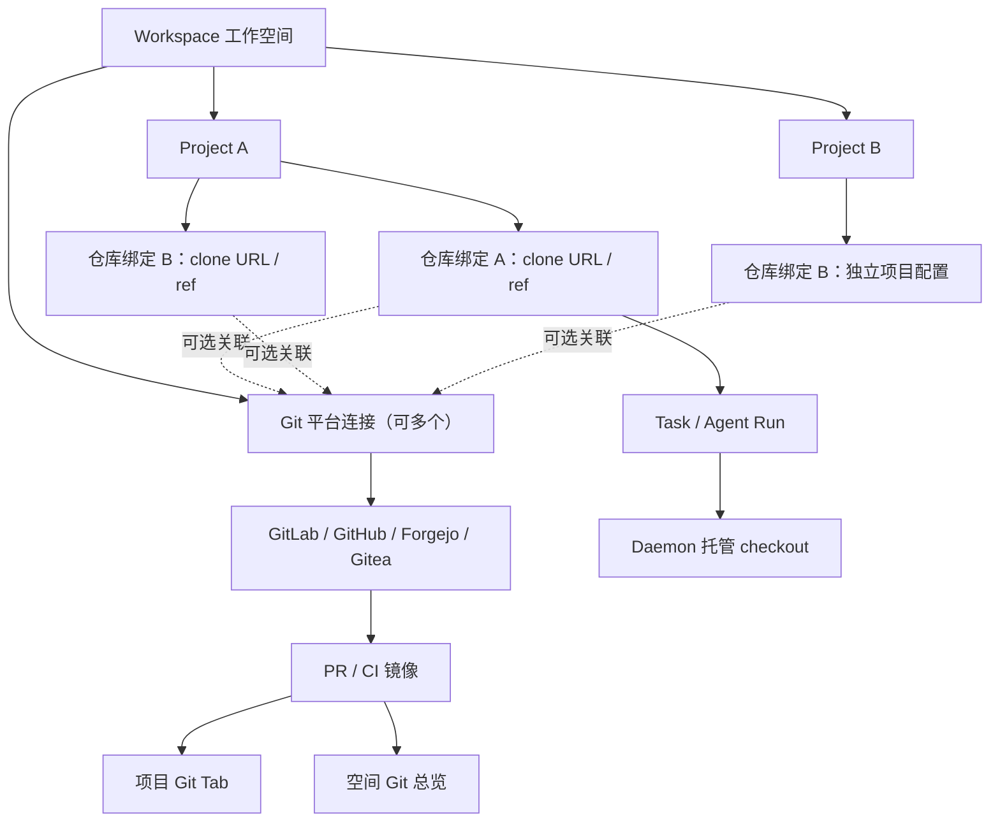

# MEPER Studio Agent OS — 项目级 Git 绑定与交付视图设计 V2

> 状态：P0–P4 主链路已落入根目录源码，并已在 yilia 测试服务完成后端部署、数据库迁移和基础 API 冒烟验证；待真实 Git 平台与运行链路手动联调。P5 保留为后续增强。
>
> 日期：2026-11-25
>
> 基线：根目录现有源码；V2 取代原「方案 A + 双层归属 + Git 独立 Tab」设计。
>
> 核心原则：**Workspace 管连接，Project 管仓库，Task 管工作，Agent 管执行，Git 管代码变更与质量状态。**
>
> 本文描述目标架构和实施计划，不代表新增功能已经上线。

---

## 0. 背景、范围和当前事实

### 0.1 当前源码能力

| 层面 | 当前事实 | V2 处理方式 |
| --- | --- | --- |
| 项目仓库 | `project_resource` 的 `github_repo` 已支持 URL、checkout ref、主仓库；历史类型名虽为 github_repo，实际支持其他 Git 平台 | 保留资源类型和现有 API，作为仓库绑定权威数据 |
| 任务领取 | 项目存在仓库时覆盖空间默认仓库；项目无仓库或任务无项目时仍回退至 `workspace.repos` | 明确继承模式，统一任务、Chat、Quick Create 的仓库解析 |
| Daemon | 已有项目资源注入、裸仓库缓存和按 run 区分的 ref；允许列表仍部分为工作空间级 | 缓存继续共享，按本次运行区分托管 checkout 范围 |
| 自托管 Git | `vcs_connection` 按工作空间连接 GitLab / Forgejo / Gitea | 保留连接、Token、Webhook 生命周期，不按项目复制 |
| GitHub | 使用工作空间级 GitHub App installation 及独立 PR/CI 镜像 | 保留原接入链路；项目视图聚合已有镜像 |
| PR / CI | 已可按任务合并查询 GitHub 和自托管 VCS PR；CI 通知主要依赖任务关联 | 增加按项目、工作空间聚合查询与事件刷新 |
| Git 设置 | `workspace.repos` 同时作为默认仓库、仓库选择来源和 Daemon 预热配置 | 保留兼容数据和配置入口，降级为明确的默认仓库 |
| 前端 | 项目详情已有 Tasks / Resources / SOP；资源页已有仓库、本地目录管理 | 增加 Git Tab，复用管理组件，不再重复实现 Git CRUD |

上述事实依据：`core/internal/handler/daemon.go` 的三条仓库构造路径（task、chat、quick-create）、`core/internal/daemon/daemon.go` 的 `registerRunRepos`、`workspaceRepoAllowed`、`clearRunRepoRefs`，以及 `core/internal/handler/github.go` 的 `ListPullRequestsForTask`。

以上为实施前基线。当前根目录已新增绑定投影、Git API 及项目/空间 Git 页面；已部署至 yilia 测试服务（见 7.1）。

### 0.2 目标

1. 项目可独立绑定一个或多个 Git 仓库，指定主仓库、checkout ref、默认分支提示、本地目录映射。
2. Git 平台凭证在 Workspace 统一管理，绑定仓库不强制连接 Git 平台。
3. 项目 Git Tab 展示本项目的仓库、PR/MR、关联任务和 CI 状态。
4. 工作空间 Git 页提供跨项目总览，同一仓库及 PR 支持多项目关联而不重复计数。
5. 明确代码执行与 PR/CI 镜像同步的区别，避免用户误判仓库权限、同步状态。
6. 保留历史数据和老客户端兼容能力，能够分阶段交付。

### 0.3 非目标

- 不把 `vcs_connection` 或 GitHub App installation 改为项目级，也不把连接 Token 下发给 Agent。
- 不替换现有 `github_repo` 资源类型名，不重构已有任务、工作流和本地目录数据模型。
- 不把 Git 页面扩展成完整 Git 客户端、代码审查编辑器或 CI 编排系统。
- 第一期只管理已接入的 PR/MR 与可确定归属的 CI 镜像；完整历史导入、自动 Webhook 注册、Pipeline/Job 明细为后续增强。
- Daemon 的托管 checkout 约束不等价于操作系统或 Git 平台本身的权限隔离。

## 1. 领域模型和使用流程

### 1.1 双层归属



| 对象 | 权威归属 | 职责 |
| --- | --- | --- |
| Git 平台连接 | Workspace | 实例地址、平台类型、访问凭证、Webhook、GitHub 授权 |
| 仓库绑定 | Project | Clone URL、主仓库、checkout ref、可选的平台映射 |
| 仓库镜像 | Workspace + 平台仓库身份 | PR/MR、CI 的状态事实与仓库来源 |
| Task ↔ PR 关联 | Task | 任务引用、工作 PR、close intent；不等同于仓库归属 |
| 本地目录映射 | Project + repository resource + daemon | Agent 本机执行位置及已有工作树选择 |
| 运行仓库集合 | Agent Run | 本次托管 checkout 的仓库快照和 ref |

**一个 Workspace 可以连接多个 Git 实例；一个 Project 可以绑定多个仓库；一个仓库也允许绑定多个 Project。** 一条平台连接所能访问的仓库仍取决于凭证和平台授权范围，不代表该实例中的所有仓库都已授权。

### 1.2 用户流程

1. Workspace 管理员可在 Settings → Git 连接公司 GitLab，或者使用现有 GitHub App。
2. 项目负责人进入项目 Git Tab，粘贴 Clone URL，或从已有连接授权的仓库、默认仓库、其他项目仓库中选取（连接授权仓库列表按平台能力逐步提供）。
3. 选择主仓库、checkout ref、本地目录映射；如可识别平台连接，则关联已有连接。
4. Task 分配给 Agent 时，按项目仓库模式解析此次运行的仓库集合。
5. 已配置平台集成和 Webhook 的仓库展示镜像 PR、CI；未配置集成的仓库仍可正常由具备 Git 认证能力的 Daemon 使用。

例如 Workspace「研发中心」连接一次公司 GitLab；MEPER Studio 项目绑定 frontend/backend，仿真平台项目绑定 simulation-core。各项目无需分别配置 GitLab Token。

### 1.3 权限及能力边界

- Workspace owner/admin：连接、断开、轮换凭证、管理默认仓库。
- Workspace owner/admin 或 member 类型的 project lead：管理该项目的仓库配置；沿用现有 `requireProjectResourceManager`。
- 普通工作空间成员：按现有工作空间读取规则查看项目及 Git 总览；不返回凭证或 Webhook secret。
- Agent run token：沿用现有只读资源管理规则，不能修改未来运行的项目仓库配置。
- 本地目录映射：沿用现有 Daemon 所有者及项目管理权限、Desktop 本地目录校验。
- 所有查询和写入同时使用 workspace 身份和 project/connection 身份校验归属，不依赖仅凭 ID 查询的结果。图表、PR 卡片和任务跳转也遵循相同读权限。
- 平台连接凭证服务于平台 API 和镜像管理，不替代运行机器自己的 Git/SSH 认证；连接状态与实际 clone 能力分别展示。

## 2. 数据模型与仓库身份

### 2.1 项目资源仍是唯一权威

沿用 `project_resource(resource_type='github_repo')`，扩展其 JSONB `resource_ref`（示意）：

```json
{
  "url": "git@gitlab.example.com:team/studio.git",
  "ref": "develop",
  "default_branch_hint": "main",
  "primary": true,
  "integration": {
    "kind": "vcs",
    "connection_id": "<workspace connection id>",
    "repository_path": "team/studio",
    "external_repo_id": "<verified provider repository id>"
  }
}
```

- `url` 保持为实际 Clone URL，Daemon 继续读取原字段。
- `integration` 整体可空，Git 平台接入不是绑定仓库的前置条件。
- `kind` 为 `vcs` 或 `github_app`；GitHub 使用工作空间 installation 记录 ID，查询时解析其外部 installation ID。
- `external_repo_id` 仅保存平台已验证的稳定仓库 ID，不从 URL 猜测。历史仓库可先按路径映射。
- `repository_path` 是对应平台中的完整路径，支持 GitLab 多级子组。
- 更新 Go `githubRepoRef`、TypeScript `GithubRepoResourceRef` 和归一化逻辑，确保旧客户端修改 ref/label/primary 时不会意外丢失新增平台映射。契约：普通编辑保留未提交的 integration；显式清空才解除映射；Clone URL 变化后重新确认映射。
- `primary` 仍存在资源中，不在派生绑定表重复持久化。

### 2.2 派生索引表 `project_repo_binding`

建议建立轻量的查询投影，避免每次 PR 查询解析资源 JSON；不再把冗余的主仓库、label、ref 当作第二份权威数据。

以下是逻辑结构，实际 migration 与现有 sqlc/schema 约定保持一致：

```sql
CREATE TABLE project_repo_binding (
    resource_id       UUID PRIMARY KEY,
    workspace_id      UUID NOT NULL,
    project_id        UUID NOT NULL,
    clone_key         TEXT,     -- 规范化 clone locator；仅用于辅助匹配
    connection_kind   TEXT,     -- vcs | github_app；未关联时为空
    connection_id     UUID,     -- Workspace 下的本地连接记录 ID
    repository_path   TEXT,     -- 经平台/连接解析的路径
    external_repo_id  TEXT,     -- 可空；经验证的平台仓库 ID
    created_at        TIMESTAMPTZ NOT NULL DEFAULT now(),
    updated_at        TIMESTAMPTZ NOT NULL DEFAULT now(),
    CHECK (connection_kind IS NULL OR connection_kind IN ('vcs', 'github_app')),
    CHECK ((connection_kind IS NULL) = (connection_id IS NULL))
);

CREATE INDEX idx_project_repo_binding_project
    ON project_repo_binding (workspace_id, project_id);
CREATE INDEX idx_project_repo_binding_path
    ON project_repo_binding (workspace_id, connection_kind, connection_id, repository_path);
CREATE INDEX idx_project_repo_binding_external
    ON project_repo_binding (workspace_id, connection_kind, connection_id, external_repo_id);
```

设计约束：

- 一条 Git 仓库资源对应一条投影：`resource_id` 唯一。
- 同一仓库可属于多个项目；同一项目原则上只绑定同一规范化仓库一次。先报告存量重复，再在完成兼容整理后使用数据库约束/事务内锁保证唯一性；不自动删除可能含不同 ref、本地映射的历史资源。
- 从资源表和真实连接派生字段；校验 workspace、project、resource、connection 四者的归属一致。
- 沿用当前数据库应用层关联清理和锁协议，不因为此新增表引入另一套级联机制。显式更新项目/工作空间删除清理 SQL 及 `core/pkg/db/relational` 的锁/清理依赖。
- Git 平台连接断开不能删除仓库资源。连接映射标记为断开/待重连，Agent 的 Clone URL 和本地目录不受影响；重新接入需验证身份后关联，不盲目关联同名实例。
- 连接与仓库映射存续、镜像数据保留是独立生命周期；当前 VCS 断开连接会清理镜像 PR/CI。第一期兼容现有删除行为，并在断开确认中说明；长期历史保留可独立设计。

### 2.3 Clone URL 与平台身份分离

现有 `NormalizeInstanceURL` 只清理首尾空白和末尾斜杠（`core/internal/integrations/vcs/forgejo.go`），不能作为仓库身份解析器。

```text
clone_url：Daemon 克隆地址（原样保存有效配置）
instance_identity：经过规范化的 Git API 实例/连接地址（含 scheme、端口、必要的部署子路径）
repository_identity：provider + instance_identity + external_repo_id（优先）/ canonical repository path（兼容）
```

实现建议：

- 在 `core/internal/integrations/vcs/repo_url.go` 新建共享解析器，解析 http(s)、ssh://、scp-like、git:// 等现有支持的有效 Clone URL，保留端口、多级 namespace、路径大小写语义、部署前缀以及 .git 后缀处理规则。
- 明确配置或平台提供的 clone/API 地址映射优先；SSH 端口与 HTTP API 端口不是同一概念，不能无条件把 SSH URL 转换成 https origin。
- 主机规范化与提供商路径规范化各自独立。使用相同的规范化规则处理 URL、连接、Webhook 身份；不无条件将所有仓库路径小写。
- HTTPS/SSH 等不同 Clone URL 可能指同一仓库，仓库映射应以平台已验证身份为准，实际 Git 传输配置继续使用原 Clone URL。
- GitLab / Forgejo 等 adapter 增补 provider repository ID（平台事件有此字段时）；现有 PR 镜像只保存 owner/name，需增量补充外部 ID。旧镜像仍按已验证的连接 + 仓库路径匹配；仓库改名后的历史关联只有获得可靠 ID/别名证据时才补齐。
- 解析不充分的已有合法 Clone URL 仍可保存、执行；投影标为待解析/仅代码访问，不强制拒绝原先受支持的资源。新增显式平台映射必须校验，不允许映射到其他 Workspace。
- 同一项目接入同一仓库的不同 URL 时提示潜在重复；不能确认身份时不伪造归属。
- 连接映射以资源中的 integration 为权威。缺少 integration 的存量资源先生成 clone locator 和候选映射；仅在连接及仓库身份唯一、具有可验证平台数据时，通过统一资源写服务保存映射并更新投影；否则提示项目负责人确认，不让派生表形成独立的绑定事实。

### 2.4 写入事务与一致性

| 必须覆盖的写入口 | 当前源码位置 |
| --- | --- |
| 创建项目时创建资源批次 | `core/internal/handler/project.go:390` |
| 添加资源 | `core/internal/handler/project_resource.go:329` |
| 更新资源（含普通非 primary 更新） | `core/internal/handler/project_resource.go:474` |
| 切主仓库并降级旧主仓库 | `core/internal/handler/project_resource.go:719` |
| 删除资源、删除关联本地目录、提升新主仓库 | `core/internal/handler/project_resource.go:744` |
| 删除项目或工作空间 | `core/pkg/db/queries/{project,workspace}.sql` 与对应 handler |
| 批量迁移/复制默认仓库 | 新流程，必须复用相同写服务 |

统一资源写服务/事务边界，资源 + 派生投影 + 主仓库调整同时提交；事件在提交后发布。所有 Git 资源更新路径均进入事务，同项目修改序列化并使用已有锁协议，避免并发产生重复绑定、多个主仓库、状态不一致。

主仓库规则：有仓库时恰好一个 primary；删除主仓库按现有 position 顺序提升。历史无 primary / 多 primary 资源由迁移报告并确定性整理，不能在每次读取时静默修改。

## 3. Agent 执行范围与兼容策略

### 3.1 明确仓库模式

建议新增项目级配置 `repo_mode`，与仓库列表分离：

| 模式 | 已绑定仓库 | 无已绑定仓库 |
| --- | --- | --- |
| `inherit`（兼容） | 使用项目仓库，覆盖默认仓库 | 继承 `workspace.repos` |
| `project_only` | 仅使用项目仓库 | 空仓库集合，不自动回退 |
| `none` | 不向运行下发 Git 仓库（页面提示配置需整理） | 空仓库集合 |

- 现有项目迁移默认 `inherit`，无项目任务继续使用工作空间默认仓库。
- 在服务端与 Daemon 能力完整上线之后，新项目推荐默认 `project_only`；先完成兼容发布再切换默认值。
- `none` 只控制 Agent 运行的 Git 仓库集合，不删除已配置的绑定、不影响其 PR/CI 展示，也不等于禁止既有合法的本地目录或非 Git 资源。
- 资源查询错误与「没有仓库」必须区分；读取失败时暂停/重试该次运行，不应静默回退到默认仓库。

### 3.2 托管 checkout

现有代码在以下三条 Claim 路径分别构建仓库集合：

- Task：`core/internal/handler/daemon.go:2092`
- Chat：同文件 `:2434`
- Quick Create：同文件 `:2675`

将其收敛为同一个有效仓库解析服务，在领取任务时冻结本次运行的配置快照；修改项目配置只影响后续运行。保留 `local_directory.repository_resource_id`、primary、本地工作树和 checkout ref 的既有语义。

Daemon 现有 `runRepoRefs` 已按 run 区分，但 `runRepoURLs` 仍合并于工作空间，`workspaceRepoAllowed` 也按工作空间检查。V2 的执行范围改造应做到：

- 裸仓库缓存仍可按 workspace 共享，运行 ref/checkout 范围独立。
- 托管 checkout 根据当前 run 的有效仓库快照判断范围，不把共享缓存是否存在视作许可。
- 运行结束清理此次 run 的范围和 ref；解绑仓库不影响已领取运行的快照，下次领取使用新配置。
- 服务端、Daemon 和客户端有版本兼容；不支持新模式的旧 Daemon 保留旧行为，并明确提示升级，不对其宣称项目范围已生效。
- 对托管 checkout 范围负责；直接运行 Git 或本地文件操作仍遵守用户机器、沙箱和实际 Git 平台权限。

如果只交付读写管理及 Git 展示，可先保持 `inherit` 的既有行为；只有新版 Daemon 声明支持运行级仓库范围，才允许执行显式选择的 `project_only`、`none` 模式。当前默认仍为 `inherit`，页面提供明确的升级提示，待手动联调确认后再考虑切换新项目默认值。

## 4. Git 镜像、任务关联与实时事件

### 4.1 项目归属：投影关联，不复制 PR

- 自托管 VCS：查询 `vcs_pull_request` + `vcs_connection` + 绑定投影。
- GitHub：查询 `github_pull_request` + `github_installation` + 绑定投影；沿用 GitHub App 现有安装和 PR 快照机制。
- 优先按照稳定 provider 仓库 ID 关联；历史数据按经过校验的实例/连接和规范仓库路径降级匹配。
- PR 不需要新增单一 `project_id`，因为一个 PR 可以在多个绑定同仓库的项目视图出现。
- 项目和 Workspace 列表去重键为 `provider + instance_identity + repository_identity + pr_number`，而不是仅 owner/name/number。查询保留连接/安装范围与 workspace 归属；同实例别名和重复镜像仅在身份确认后合并。
- 对一条 PR 的多项目归属返回 project IDs；Workspace 总览中只展示一条 PR 并标注所有相关项目。
- 项目 Tab 默认展示已绑定仓库的 PR，可筛选「仅本项目关联任务」；monorepo 不将所有 PR 强行归属为某项目的工作记录。

### 4.2 任务关联与自动完成

沿用既有 `task_pull_request` / `task_vcs_pull_request`、`reference_only`、`close_intent` 和跨 provider 自动完成聚合。

明确以下规则：

- 仓库归属和任务引用独立。仓库绑定某项目不代表所有 PR 都与其 Task 相关。
- 工作空间任务编号唯一只保证查找唯一，不证明仓库与任务归属兼容。
- 项目 Git Tab 中关联任务标明实际项目，保留合法跨项目引用，但不将引用等同于工作 PR 或任务完成依据。
- 新的自动完成逻辑在已有 close intent / 开放 PR 聚合规则之外，需要确认 PR 仓库符合该任务的有效仓库策略；无有效身份时不自动推进。
- 不重写历史任务链接或已完成任务；新规则需配合已有行为的兼容发布和回归测试，旧的 workspace 默认仓库项目按 `inherit` 规则过渡。

主要修改点为 `core/internal/handler/vcs_webhook.go`、`core/internal/handler/github.go` 和统一任务仓库资格判断。

### 4.3 CI 状态

现有 `vcs_commit_status` 以 connection + SHA + context 记录状态；GitLab 采用单个合成 pipeline context，存在多 Pipeline 收敛及 merge-train SHA 不等于 MR head 的局限（`core/internal/integrations/vcs/gitlab.go:174`）。

第一期：

- CI adapter 提取能够确认的仓库身份；仅在仓库、连接及 PR 当前 head 可确定匹配时展示 checks。未知显示「暂无可确认 CI 状态」而非成功。
- 为仓库级 CI 引入带 repository identity 的状态投影，键包含连接、仓库、SHA、context。采用可兼容迁移（例如新增仓库级状态表），保留当前任务 CI 查询，分阶段切换；旧无仓库身份的状态不盲目进入项目视图。
- 继续使用事件时间保护和当前 head SHA 关联；保留 passed、failed、pending 的摘要。
- 有任务关联的 PR 与无任务关联的 PR 都应响应 CI 状态更新。
- Pipeline/Job 明细、多 Pipeline、merge-train/merged-results pipeline 的精确关联作为增强阶段，第一期 UI 不暗示已有完整流水线覆盖。

### 4.4 同步状态与历史

当前自托管连接只校验账户/Token，镜像主要由 Webhook 到达后产生。绑定仓库不意味着已导入历史 PR，也不意味着 Webhook 已配置。

每个绑定要区分：

| 状态 | 说明 |
| --- | --- |
| 仅 Git 访问 | 已配置 Clone URL，未绑定平台集成；Agent 可按其机器凭证执行 |
| 待解析 / 待连接 | 绑定未能匹配可用连接或连接已断开 |
| 等待事件 | 已关联平台连接，尚未收到可确认的仓库事件 |
| 已接收事件 | 显示最近收到事件时间和已镜像数据 |
| 同步异常 / 未知 | 已观察到的同步错误、连接状态未知或 CI 归属不明 |

状态从真实连接、实际观测到的 Webhook/同步记录计算，不把「有连接记录」描述为健康，不把空 PR 列表描述为平台仓库中没有 PR。

一期「活动流」定义为近期 PR 状态更新（按 `pr_updated_at` 排序），不是完整的历史事件日志；若要展示每一次 opened、merge、CI 转换，需要后续独立事件记录及去重机制。

### 4.5 事件和刷新

在现有 `pull_request:updated` 上提供可选项目归属信息：

```json
{
  "pull_request_id": "<mirror id>",
  "project_ids": ["<project id>"],
  "linked_task_ids": ["<task id>"]
}
```

- 保留旧 payload 兼容（现有 pull_request、task_id、linked_task_ids）；新增字段不能破坏旧任务刷新。
- PR 更新、CI 状态更新、GitHub PR snapshot 更新均覆盖项目维度。自托管 CI 不再只根据 task 链接发布事件；对无任务链接的匹配 PR 也通知项目/空间。
- 资源创建/更新/删除、主仓库调整、项目变化、连接创建/删除/轮换后刷新相关 binding/PR/连接查询。所有事件在事务提交后发出。
- 前端集中接入 `packages/core/realtime/use-realtime-sync.ts`；按 Workspace + Project query key 定向失效；旧事件无 project IDs 时保守失效该空间的 Git 查询。重连时重新拉取可见页面，避免只依赖实时通知。
- Webhook 仍沿用 provider adapter 的认证、事件时间及幂等处理；为持久化失败补充可观测错误与可恢复重试策略，不把接收事件等同于镜像写入成功。

## 5. API 和前端数据契约

### 5.1 API

沿用项目和 Workspace 现有路由约定，项目资源增删改仍使用 `/api/projects/{id}/resources`，不构建平行写 API。

| 端点 | 用途 |
| --- | --- |
| `GET /api/projects/{id}/git/overview` | 项目仓库、有效仓库模式、同步摘要、PR 数量等轻量信息 |
| `PUT /api/projects/{id}/git/repo-mode` | 项目负责人/管理员修改运行仓库策略；默认保持 inherit |
| `GET /api/projects/{id}/git/pull-requests` | 项目 PR 列表；cursor 分页、状态/仓库/关联任务过滤 |
| `GET /api/workspaces/{id}/git/overview` | Workspace 聚合摘要、项目/仓库计数、连接配置状态 |
| `GET /api/workspaces/{id}/git/bindings` | Workspace 绑定列表，可按项目/仓库筛选并分页 |
| `GET /api/workspaces/{id}/git/pull-requests` | Workspace 去重后的近期 PR 活动流，含项目归属；支持 `task_id` / `task_query` 关联任务筛选 |
| `GET /api/projects/{id}/git/pull-requests/{prId}/files` | 当前项目已绑定的 PR/MR 文件列表及文本 Diff，按页实时读取平台 |
| `GET /api/workspaces/{id}/git/pull-requests/{prId}/files` | Workspace 已绑定的 PR/MR 文件列表；可附加项目 scope |
| `GET /api/workspaces/{id}/vcs/connections` | 已有自托管连接列表、available/configured/can_manage |
| `GET /api/workspaces/{id}/github/installations` | 已有 GitHub installation 列表 |

项目读取沿用 `loadProjectForResource` 一类 workspace scope 校验及成员权限；Workspace 路由按已有成员级和管理级中间件区分。返回 DTO 不暴露连接凭证。

- 现有 `GitHubPullRequestResponse` 和前端 `GitHubPullRequest` 继续作为 PR 基础形状，但增加项目级 DTO（例如 `ProjectGitOverview`、`ProjectGitBinding`、`GitPullRequestItem`、分页 response），通过组合附加 repository identity、project refs、task refs、同步状态。不能假设完全无需新增类型。
- 排序建议 `pr_updated_at DESC, id DESC`；cursor 使用同一稳定组合。跨 provider 聚合必须先统一筛选/去重再分页，不在两个分页结果前端拼接。
- 关联任务使用批量查询，不为每条 PR 发起单独 DB 查询；分页后批量加载 PR 的 checks 与相关任务，避免全空间一次拉全和 N+1。
- 复用现有 sqlc 查询风格，增加 project/connection/repo lookup、按项目 PR 查询和按 workspace PR 查询。按代表性工作空间数据规模检查查询计划、索引及分页性能。

### 5.2 项目详情 Git Tab

项目详情现有 `section=resources` / `section=sop` 导航，新增 `section=git` 及 `paths.projectGit(id)`。

- 仓库区：主仓库、URL、checkout ref、默认分支提示、label，本地目录/Daemon 映射、关联平台、同步状态。
- 资源管理复用 `ProjectResourcesSection` 内既有的 Git 仓库、本地映射、选取默认仓库和 CustomRepoForm，提取可复用子组件；Git Tab 为仓库管理主要入口，Resources 保留文件和其他资源、显示仓库摘要或跳转，不重复建设编辑入口。
- 未设置仓库时根据 repo_mode 解释当前实际使用的默认仓库或空集合。
- PR 区：复用任务页 `PullRequestRow` 的基础 UI（提取与任务查询解耦的展示组件），提供状态、checks、关联任务、原文链接、仓库和当前项目筛选。
- 连接与 Webhook 未配置时仍允许仓库绑定；提示下一步并根据用户权限提供跳转到 Settings，而非把项目创建拦在连接前。

### 5.3 Workspace 独立 Git 页

- 「项目仓库」：按项目分组查看仓库绑定、主仓库、项目状态、同步状态。
- 「PR / MR」：跨项目近期状态更新、状态/仓库/项目过滤、关联任务跳转。同一 PR 只显示一次，标明相关项目。
- 「连接摘要」：只展示已配置平台、配置/同步观测，点击进入 Settings 管理；不提供第二套凭证编辑页面。
- 默认仓库作为独立组/提示展示，与明确绑定到项目的仓库区分。

新增共享页面 `packages/views/git/` 及其 exports；注册 `packages/core/paths/paths.ts`、`route-icons.ts`、侧边栏导航、保留 slug / tab 标题映射、Web 实际页面与 Desktop router；为新增内容添加 en、zh-Hans i18n。移动端不要求一期新增 Git 页面，但协议兼容，既有任务视图不回归。

### 5.4 Settings → Git

| 配置对象 | 决定 |
| --- | --- |
| 自托管 VCS Connection | 保留，连接、轮换、断开仍由 Workspace 管理员执行 |
| GitHub App | 保留原安装、授权、仓库选择能力 |
| `workspace.repos` | 保留，命名为「工作空间默认仓库」，说明无项目任务与继承模式的用途 |
| 项目绑定总览 | 显示简要摘要和 Git 页面链接，不在设置中重复编辑 |
| 旧仓库清单入口 | 在新入口及迁移流程可用后收敛；保留兼容读写 |
| 从默认仓库迁移到项目 | 选择目标项目和仓库，预览重复项、保留现有映射；默认执行复制/绑定，不自动删除原默认仓库 |

现有 GitHub 导入仓库和从 workspace 默认仓库快速选择的体验必须保留或提供等价新入口。

## 6. 数据迁移与上线策略

不采用「每次 Server 启动全量重建绑定表」作为正常运行机制。

1. **Expand**：添加绑定投影、可选映射字段、repo_mode、新的 CI/仓库身份字段或投影；老数据和旧 API 可用。
2. **双写**：覆盖全部资源写入口，并与已有事务、项目/工作空间清理锁协议统一；新增记录实时建立投影。
3. **分批回填**：通过持久化迁移任务/运维命令执行，可重复运行、可续跑；多 Server 实例通过协调机制避免重复全量扫描。每批从当前权威资源读取、验证后 UPSERT，保护并发编辑；不先清空整个表。
4. **异常报告**：可解析/仅 Git 访问/歧义、重复仓库、主仓库异常分别统计。保留全部原始资源、本地目录及历史任务链接；不可确认的数据不强行补映射。
5. **验证与切流**：对比源资源和投影数量、workspace/project 归属、重复及缺失项；按需运行修复/对账，再开启新 Git 查询与 UI。
6. **兼容收敛**：先部署 Server、Daemon、Desktop/Web，然后才开放非兼容的执行模式；历史 workspace 默认仓库保持不变，用户主动迁移后再考虑收敛。
7. **回退**：先关闭新查询/UI/执行模式，旧资源 API 和继承行为保持可用。新增表/列的 down 仅移除派生数据，不删除原有资源或 PR 镜像；双写与迁移代码按版本顺序停用。

对于新旧客户端并存：新 Server 必须保留已有资源 JSON 语义，旧 Daemon 仍可领取兼容模式；页面展示实际能力，不提前切换到未支持的执行模式。

## 7. 阶段与交付物

| 阶段 | 范围 | 验收门槛 |
| --- | --- | --- |
| P0 基础模型 | 连接/Clone/仓库身份协议、资源写服务、归属与并发规则、兼容模式；迁移脚本及测试 | 所有写入口可保持一致，URL/身份解析测试通过，确认迁移与回退策略 |
| P1 后端镜像/API | 绑定投影回填、项目和空间分页 API、GitHub 与 VCS 聚合、CI 归属及事件、任务关联资格 | 多项目/多实例无误计数，未关联任务的 PR 能按 CI 更新刷新，API 权限与分页验证 |
| P2 项目 Git Tab | 仓库管理、PR/CI、平台接入/同步状态、与 Resources 衔接 | 现有仓库 CRUD、本地目录映射、任务跳转正常，旧配置可见 |
| P3 Workspace Git 页 | 主导航、项目绑定总览、跨项目 PR、连接摘要 | Web 与 Desktop 实际路由、i18n、实时刷新完整 |
| P4 执行与设置收敛 | 统一 Claim 仓库解析、Daemon run 范围、模式能力协商；Settings 默认仓库迁移 | 旧版兼容、无仓库项目不误回退，运行快照及本地目录测试通过 |
| P5 增强 | 历史 PR 初始同步/对账、连接健康探测、仓库授权列表、自动 Webhook、Pipeline/Job 明细、完整事件流 | 依据平台能力和权限分别实施 |

依赖关系：P1 依赖 P0；P2、P3 依赖 P1，可并行实现；P4 的设置收敛依赖 P2/P3 的可用入口，执行模式必须等待 Server/Daemon 能力验证。P5 独立增量。

P0–P4 的主链路已实现源码，严格模式需新版 Daemon 与后端共同部署，当前不自动切换任何项目的模式。P5（完整历史导入、自动 Webhook、健康探测及完整 Pipeline/Job 记录）暂未实现。

### 7.1 当前代码交付与手动联调

已新增的实现入口：

- `core/migrations/0374_project_git_bindings.{up,down}.sql`：绑定投影、provider repository ID、仓库维度 CI 镜像。
- `core/migrations/0375_project_repo_mode.{up,down}.sql`：项目运行模式（默认为 inherit）。
- `core/internal/projectgit/bindings.go`、`core/internal/integrations/vcs/repo_url.go`：统一映射、规范化、事务投影和兼容管理。
- `core/cmd/git-bindings-backfill`：显式运行、分批且可续跑的存量回填；报告无法确认的映射、重复及主仓库问题，不自动删除任何重复资源。
- `core/internal/handler/project_git.go`、`project_git_claim.go`：查询、仓库模式、运行集合解析。
- `core/internal/daemon/project_repo_scope.go`：由新版 Claim 协商的运行级托管 checkout 范围。
- `packages/views/git/`：项目 Git Tab、空间 Git 总览、平台映射、默认仓库绑定、模式管理，Web/Desktop 共享。

**部署/手动测试顺序（在用户确认的目标测试数据库上操作，不在开发过程中自动执行）：**

1. 按现有部署方式应用 0374、0375 迁移；确认所有 Server 实例升级至同一版本。
2. 从根项目的 `core` 目录运行回填：

   ```sh
   go run ./cmd/migrate up
   go run ./cmd/git-bindings-backfill -batch 100
   ```

   两条命令使用部署环境预先配置的 `DATABASE_URL`。回填支持 `-after <project UUID>` 续跑。先在测试环境核对输出，存量原始仓库 URL、本地目录和任务链接保留；同一项目有重复候选时不强制修复其 primary。
3. 更新并启动后端、Desktop/Web 和 Daemon。默认 inherit 保持现有行为；只在升级的 Daemon 环境手动选择其他模式。
4. 新建或打开项目 → Git → 绑定仓库；可不连接平台直接配置 Clone URL。已有平台连接时附加关联、填写完整仓库路径，再按现有设置配置 Webhook。
5. 使用第 8 节的关键用例手动验收。尚未进行真实 GitLab/GitHub webhook 联调。

**2026-11-25 yilia 测试部署记录：**

- 测试入口：`http://yilia.me:6688`。从根目录源码构建 Linux AMD64 Go 服务及迁移/回填工具，仅替换 backend 容器，保留既有 Web 和 PostgreSQL 容器。
- 0374、0375 迁移及 Git 绑定回填成功；历史项目仍为 `inherit`，原项目与本地目录资源保留。
- 健康检查正常；11 项已认证 Git 查询 API 返回 200。在 Silieco Test 工作空间使用临时项目验证仓库创建、ref 更新、模式切换和 PR 空态查询，随后删除临时项目，数据恢复原数量。
- 回退保留：`silieco-backend:rollback-meper-git-v2-20261125045438`；迁移前数据库备份位于服务器 `/opt/silieco-internal/releases/meper-git-v2-20261125045438/before.dump`。
- 根目录 Desktop App 已重新启动，本地 Daemon 已用新版 CLI 重启并正常连接 yilia。
- 本次未执行全量测试；真实 Git 平台连接、Webhook、CI 及 Agent checkout 运行链路仍需手动验收。Web 前端未在本次部署中更新。

**Git Tab 交付视图增量（2026-11-25）：**

- Workspace 与项目 Git Tab 使用统一 Select/Checkbox，项目视图将 PR/MR 列表移至仓库设置前。支持按任务编号、标题、当前工作空间任务标识（如 SILI-123）及精确任务 ID 筛选；筛选覆盖服务端完整分页数据。
- PR/MR 行新增文件变更入口，通过 `project_git_files.go` 按需读取 GitLab MR diffs 和 GitHub PR files；文件名、变更类型、重命名、可用增删统计及文本差异均可查看。支持分页、当页文件过滤、超限/二进制提示和返回原平台。Forgejo/Gitea 暂保留原平台跳转。
- 文件读取只使用已验证的 Workspace/项目绑定和已存平台连接；GitHub 临时 token 限制到对应仓库的 PR 只读权限，服务端不提供凭证给前端，不存储源码差异。Agent run token 不具备该平台文件读取权限。
- yilia 测试服务已增量部署，未新增迁移；回退镜像 `silieco-backend:rollback-meper-git-files-20261125-1313`。前端类型检查、GitHub/GitLab 模拟 provider 测试、11 项已认证任务筛选和未知 PR 文件接口冒烟检查通过。当前 Workspace 未接入实际平台，仍需真实 MR/PR 联调。
- 后续建议把 Task 详情的交付记录与 AgentRun 变更快照统一：以任务→运行→仓库/分支→提交→MR 为主线，区分未提交本地文件、提交历史和平台最新 Diff；不要把多个 MR 的变更文件数简单相加。

**工作资源导航收敛（2026-11-25）：**

- Workspace 侧边栏与 Project 次级菜单统一为「工作资源」，其下使用三子 Tab：资源库（共享/引用文件）、工作文件（已绑定机器目录浏览、预览和目录管理）、Git（仓库管理、PR/MR 与代码交付）。Workspace 工作文件通过项目选择器限定范围；Project 工作文件直接使用当前项目。
- Canonical 导航为 `/{slug}/resources?tab=git|files`、`/{slug}/projects/{id}?section=resources&tab=git|files`，默认资源库。旧 Workspace `/git`、Project `?section=git` 与独立目录 `/projects/{id}/files` 仍可访问；目录浏览器保留「在新标签页打开」。本次仅变更前端，不新增服务端接口或迁移。

## 8. 验收测试清单

| 测试组 | 应覆盖 |
| --- | --- |
| URL/identity | HTTPS、HTTP、自定义端口、SSH、scp-like、git://、多级子组、部署子路径、.git、host/path 大小写；不同实例同名仓库不能混淆 |
| 写路径 | 创建项目时批量绑定、独立资源 CRUD、编辑 ref/label、切换/删除 primary、并发添加/修改、事务失败回滚、旧客户端编辑保留映射 |
| 关系清理 | 删除绑定、项目、Workspace；连接断开不误删仓库资源、本地目录保留；不存在跨 Workspace 数据关联 |
| 迁移 | 部分回填中断续跑、重复回填、并发编辑、存量歧义/重复、回退后旧 API 可用 |
| PR 查询 | 单项目、多项目同仓库、多实例同名仓库、GitHub + GitLab、历史路径/已验证稳定 ID、无绑定 PR、分页稳定及去重 |
| 任务语义 | 跨项目引用、reference_only、close intent、多个 provider 聚合、项目仓库与任务资格不匹配时不自动推进 |
| CI | 无任务链接的 PR、状态乱序、旧 head、多仓库同 SHA、无法确认归属时未知状态、断开/重连 |
| 执行 | task/chat/quick-create，inherit/project_only/none、资源读取错误、同仓库不同项目 ref、运行期间修改绑定、新旧 Daemon |
| UI | 项目 Git Tab、Workspace Git 导航、连接配置/未知状态、空态/local mappings、Settings 默认仓库迁移、非管理员只读能力、Web/Desktop |
| 性能 | 批量查询无 N+1、分页索引、实时事件合并/重连、多实例回填不阻塞正常服务 |

## 9. 风险和关键决策

1. **仓库身份漂移**：以平台稳定 ID、显式连接关联和共享规范化规则为主；旧路径匹配为兼容，不强制猜测。
2. **双写不一致**：统一所有资源写入路径、事务内投影和主仓库控制；显式清理、定期对账。
3. **跨项目执行误解**：区分管理、镜像、托管 checkout 三层能力；继承模式明确，严格模式能力协商。
4. **CI/PR 状态错误**：按照确认的仓库与当前 head 关联；未知不等于通过；实时事件不依赖任务链接。
5. **历史状态遗漏**：一期只展示已镜像的数据；增量初次同步与完整活动日志后续实现。
6. **GitHub 漏覆盖**：安装和授权流程不动，项目/空间读模型与现有统一 PR 卡片兼容。
7. **迁移与版本回退**：分批幂等、可续跑、保留原数据；旧客户端仍可使用默认仓库和现有任务功能。

## 附录：主要源码索引

| 文件 | 当前职责与改造入口 |
| --- | --- |
| `core/internal/handler/project_resource.go` | Git/local_directory 资源校验、CRUD、权限、主仓库控制 |
| `core/internal/handler/project.go` | 创建项目附带资源；项目删除事务 |
| `core/pkg/db/queries/project_resource.sql` | 项目资源 CRUD |
| `core/pkg/db/queries/project.sql`, `workspace.sql`, `core/pkg/db/relational/cleanup.go` | 应用层显式关联清理与删除锁 |
| `core/internal/handler/vcs.go` | 自托管 Git 连接、凭证和 Webhook 管理 |
| `core/internal/integrations/vcs/{vcs,gitlab,forgejo}.go` | provider 抽象、地址和 Webhook 解析；新增 repo_url.go |
| `core/internal/handler/vcs_webhook.go` | VCS PR/CI 镜像、task 链接、实时事件 |
| `core/internal/handler/github.go` | GitHub 安装、PR 快照、跨 provider 任务 PR 查询 |
| `core/pkg/db/queries/{vcs,github}.sql` | PR、CI、连接、任务链接查询 |
| `core/internal/handler/daemon.go` | Task/Chat/Quick Create 的 Claim 仓库和资源解析 |
| `core/internal/daemon/daemon.go`, `core/internal/daemon/repocache/cache.go` | run refs、allowlist、裸缓存和托管 checkout |
| `core/cmd/server/router.go` | Workspace/Project 路由及权限中间件 |
| `packages/core/types/{project,workspace,github,vcs}.ts` | 资源、仓库、连接、PR 类型契约 |
| `packages/core/api/client.ts`, `packages/core/projects/resource-queries.ts` | 客户端 API、查询缓存与资源 mutation |
| `packages/core/realtime/use-realtime-sync.ts` | 实时事件集中失效 |
| `packages/views/projects/components/{project-detail,project-resources-section}.tsx` | 项目详情与现有 Git/local_directory 管理 |
| `packages/views/tasks/components/pull-request-list.tsx` | 现有 PR 卡片/检查状态 UI |
| `packages/views/settings/components/{repositories-tab,vcs-tab}.tsx` | Workspace Git 连接和默认仓库管理 |
| `packages/core/paths/{paths,route-icons}.ts`, Desktop routes、Web dashboard routes | 新 Git Tab、页面和导航注册 |

**V2 结论：连接平台与绑定仓库是独立能力。以项目资源为权威、以仓库身份与连接为镜像关联基础，保留 Workspace 默认仓库兼容层，在管理/展示能力落地后逐步完善 Agent 运行范围。**
